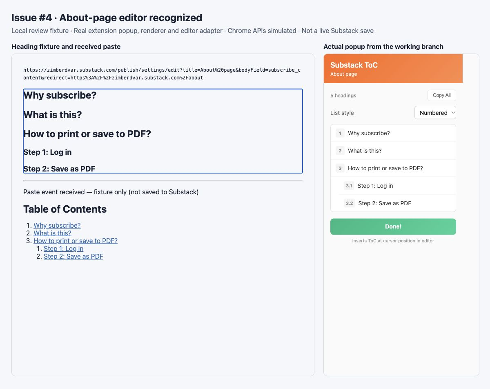
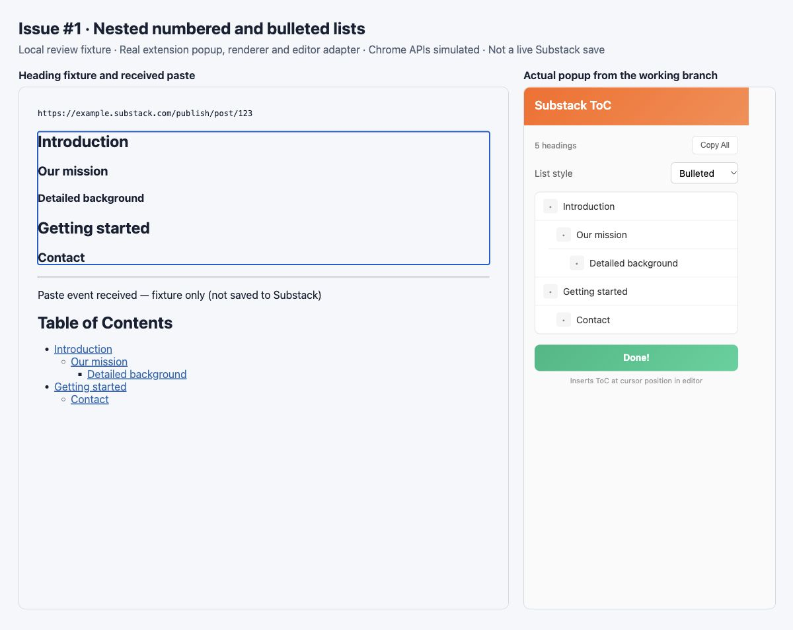

# Issue verification screenshots <!-- omit in toc -->

These captures show the actual popup, shared renderer, and editor adapter running in a local browser fixture.
Chrome APIs and the paste recipient are simulated; these are not screenshots of saved Substack content.

- [About editor](#about-editor)
- [Hierarchy and bullets](#hierarchy-and-bullets)
- [Verification boundary](#verification-boundary)

## About editor

Issue #4's URL is reproduced in `tests/fixtures/about-editor.json`, including the encoded title, `bodyField=subscribe_content`, and redirect.
The screenshot shows the popup recognizing it and a fixture receiving About fragment links.

## Hierarchy and bullets

The existing Numbered/Bulleted control preserves H2/H3/H4 nesting in the preview and received paste payload.
The underlying implementation is already on main; this is verification evidence, not another implementation of that feature.

## Verification boundary

Unit and adapter tests validate extraction, URLs, list structure, and serialized paste payloads.
Manual verification in the current Substack editor must still check copy/insertion, saving/reopening, and installed-extension behavior before release.
